### `aaban@github ~ $ cat about.txt`

Hey, I'm Aaban. I work in Cloud Defense on the Information Security team at State Farm. Before that I was on the GRC team and a penetration testing intern there. I study Informatics at UT Austin with a minor in Statistics & Data Science.

I like breaking things and then figuring out how to explain the risk to the people who have to fix it. Most of what I build sits in that space: cloud and AI security, offensive tooling, and mapping technical findings to real controls.

- ☁️ Cloud Defense, Information Security @ **State Farm** (prev. GRC and Penetration Testing Intern)
- 🎯 Built **[promptprobe](https://github.com/aabanehsan/promptprobe)**, a prompt injection testing CLI for LLM apps (39 attacks, OWASP LLM Top 10 mapped)
- ⚔️ Running a **red vs blue lab** with friends: harden Linux boxes, attack them, catch the attacker live
- 📦 Hack The Box every week with State Farm's internal hack club
- 🎓 UT Austin, B.S. Informatics '28

### `aaban@github ~ $ whoami --verbose`

### `aaban@github ~ $ ls ~/projects`

| Project | What it does | Stack |
|---|---|---|
| **[promptprobe](https://github.com/aabanehsan/promptprobe)** | Canary-based prompt injection testing for LLM apps, with CI gating and HTML reports | Python, httpx |
| **[grc-mapper](https://github.com/aabanehsan/grc-mapper)** | Maps security findings to NIST CSF 2.0, ISO 27001 and SOC 2 controls | Python |
| **[redvblue-lab](https://github.com/aabanehsan/redvblue-lab)** | Docker lab for red vs blue rounds: weak services, hardening playbooks, scoring | Docker, Ansible |
| **[vulnscan](https://github.com/aabanehsan/vulnscan)** | Multi-stage web vulnerability scanner for OWASP Top 10 issues | Python, Flask |
| **[security-notes](https://github.com/aabanehsan/security-notes)** | Pentest methodology, cheatsheets and report templates | MkDocs |
| **[recruitly](https://github.com/aabanehsan/recruitly)** | Recruiting tracker for student orgs | Python |

### `aaban@github ~ $ ./streak.sh`

### `aaban@github ~ $ cat contact.txt`

The banner and info card are generated by <a href="scripts/gen_art.py"><code>scripts/gen_art.py</code></a>, no third-party templates.
